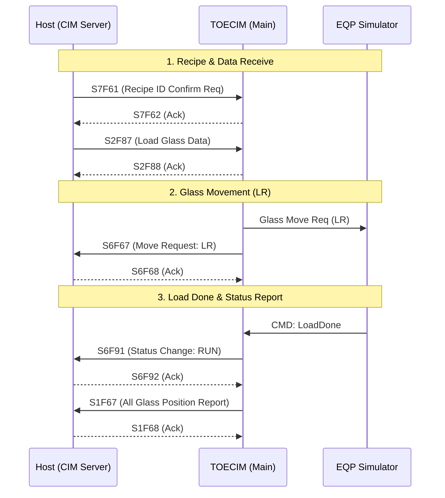
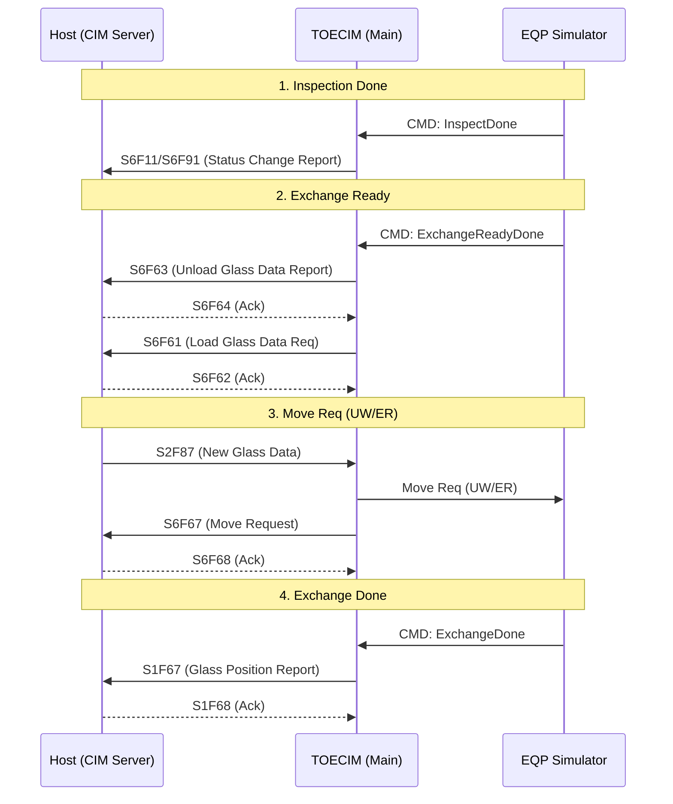
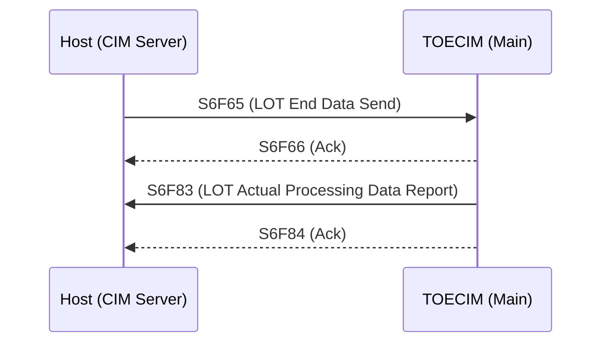

# CIM 통신 흐름 분석 보고서

이 보고서는 CIM(Communication & Interface Module)의 핵심 통신 시퀀스와 메시지 흐름을 분석한 결과입니다. `Log_2025-11-06_Log.txt` 분석을 바탕으로 작성되었습니다.

## 1. 개요
CIM 시스템은 상위 Host 시스템과 장비 시뮬레이터(Simulator) 사이의 가교 역할을 수행하며, SECS-II 프로토콜을 사용하여 데이터를 주고받습니다. 주요 시나리오별 통신 흐름은 다음과 같습니다.

---

## 2. 주요 통신 시나리오

### A. Glass 로딩 및 공정 시작 (Single Cycle)
Host로부터 레시피 확인 및 Glass 데이터를 수신하고, 장비로 이동 명령을 내린 후 공정을 시작하는 단계입니다.

---

### B. Glass 교체 및 언로딩 (Exchange Flow)
검사가 완료된 Glass를 배출하고 새로운 Glass를 투입하는 시퀀스입니다.

---

### C. LOT 종료 (LOT End)
해당 LOT의 모든 공정이 완료되어 데이터를 최종 보고하는 단계입니다.

---

## 3. 로그 분석 특이 사항

### ⚠️ 발견된 오류 및 개선 필요 사항
1. **lastValue.json 파일 접근 충돌**:
   - `TOECIM.CIMStatus.Save()` 호출 시 파일이 다른 프로세스에 의해 사용 중이라는 에러가 빈번하게 발생하고 있습니다.
   - **원인**: 여러 스레드나 이벤트에서 동시에 상태 저장을 시도할 때 발생하는 Race Condition으로 보입니다.
   - **조치 권고**: 파일 쓰기 시 Lock 메커니즘을 도입하거나 비동기 큐를 통한 순차 저장이 필요합니다.

2. **SendS6F73 NullReferenceException**:
   - `ClientCIM.SendS6F73()` 메서드 호출 시 개체 참조 오류가 발생하고 있습니다.
   - **조치 권고**: 해당 메서드 내에서 사용하는 객체(예: `HSMSGem` 등)의 초기화 여부를 확인해야 합니다.

3. **Console 연결 끊김**:
   - `ReqEqData` 호출 시 `Console 연결되지 않음` 에러가 발생하며 서버 연결이 수시로 끊기는 현상이 관찰되었습니다.
   - **조치 권고**: 네트워크 상태 점검 및 재접속 로직의 안정성 보완이 필요합니다.
