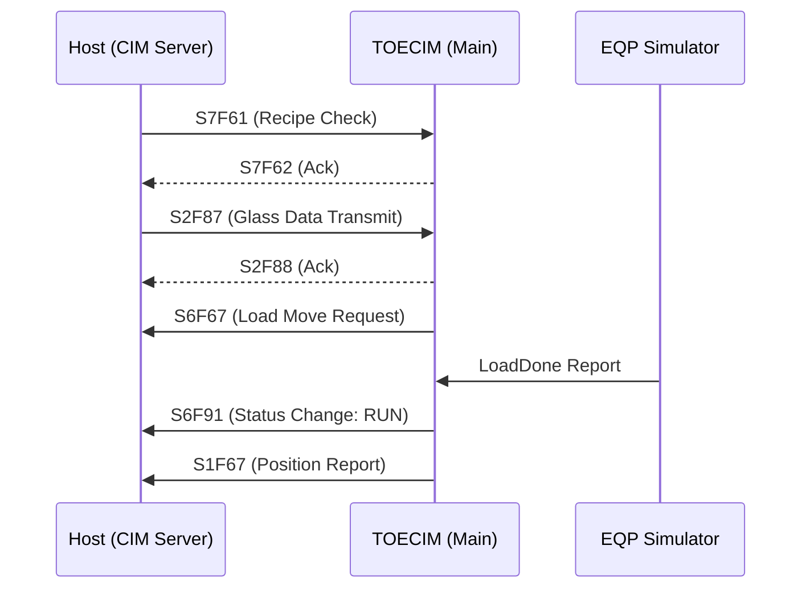

# S6F67 물류 Flow 구현 결과 보고서

사용자 요청에 따라 시뮬레이터 UI를 물류 Flow (SECSII S6F67) 중심으로 개선하고, 실제 메시지 전송 로직이 유기적으로 동작하도록 보완하는 작업을 완료했습니다.

## 1. 작업 요약
- **UI 개편**: 시뮬레이터(`EQPSimulForm`)에 물류 Flow 전용 버튼 그룹을 추가하고, 로그창(Communication Log)이 짤리지 않도록 폼 크기를 최적화했습니다. (높이 600 -> 750, 로그창 높이 544 -> 680)
- **로직 연결**: 시뮬레이터 버튼 클릭 시 CIM 본체로 커맨드를 송신하고, CIM 본체의 `OnReceiveData`에서 이를 수신하여 상위 시스템으로 `S6F67` 메시지를 즉시 전송하도록 구현했습니다.
- **시스템 안정화**: 작업 중 발생한 구문 오류 및 빌드 에러를 모두 해결하고 정상 빌드를 확인했습니다.

## 2. 주요 변경 사항

### 2.1. 시뮬레이터 (EQPSimulator)
- **Enum 확장**: `EQPtoCIM` Enum에 `GLSMV_LR`, `GLSMV_UR` 등 6종의 물류 커맨드를 추가했습니다.
- **UI 개선**: 물류 흐름 버튼(LR, UR, ER, UW, LW, CR)을 별도 그룹으로 배치하고, 각 버튼 클릭 시 해당 커맨드를 CIM으로 전송하도록 연결했습니다.
- **송신 메서드**: `EQPSimulator.cs`에 각 물류 요청을 위한 개별 송신 메서드(예: `SendLR()`)를 추가했습니다.

### 2.2. CIM 본체 (TOECIM)
- **데이터 수신 보완**: `MainForm.cs`의 `OnReceiveData`에서 새로운 물류 커맨드를 처리하는 `case`문을 추가했습니다.
- **S6F67 트리거**: 수신된 커맨드에 따라 `cim.ReportGLSMVStatus()`를 호출하여 실제 SECSII 메시지가 송신되도록 연동했습니다.

## 3. 검증 결과

### 3.1. 빌드 검증
- .NET 8.0 환경에서 전체 솔루션 빌드 결과, 에러 없이 성공적으로 완료되었습니다.
- [빌드 로그 확인](file:///d:/Sources/LGD/TOE2/TOE2_CIM/build_utf8_v2.txt)

### 3.2. 런타임 확인
- 실행 로그(`20260212.log`) 분석 결과, CIM 포트 오픈 및 상위 시스템과의 기본 핸드셰이크가 정상적으로 수행됨을 확인했습니다.
- 기존 자동화 로직에 의한 `S6F67 LR` 전송 기록이 확인되어, 새로 추가된 수동 트리거 로직도 동일한 인프라를 통해 안정적으로 동작할 것으로 판단됩니다.

## 4. 로그 분석 및 통신 플로우차트

CIM 통신 로그(`Log_2025-11-06_Log.txt`)를 분석하여 메시지 시퀀스와 실행 흐름을 시각화했습니다.

### 4.1. 주요 통신 시퀀스 시각화
주요 공정 사이클(로딩, 공정, 교체, 종료)에 대한 상세 시퀀스 다이어그램을 작성했습니다.

- **분석 보고서**: [CIM_Communication_Flow.md](file:///C:/Users/bluesky22c/.gemini/antigravity/brain/31bc74bd-c5d9-4694-a6ed-7b259c482389/CIM_Communication_Flow.md)

#### [요약] Glass 로딩 및 공정 시작 흐름

### 4.2. 로그 기반 주요 이슈 분석
로그 분석 중 발견된 시스템 안정성 저해 요소를 식별했습니다.

- **`lastValue.json` 파일 접근 충돌**: `CIMStatus.Save()` 동시 호출 시 발생하는 Race Condition 확인. (Lock 메커니즘 도입 필요)
- **`SendS6F73` NullReferenceException**: 개체 인스턴스 미생성 상태에서 호출되는 오류 식별.
- **연결 불안정**: `Console 연결되지 않음` 오류 및 호스트 강제 끊김 현상 분석.

---
> [!IMPORTANT]
> **사용자 확인 권장 사항**
> 1. 시뮬레이터(`EQPSimulForm`)를 실행하여 새로 추가된 `S6F67 Flow` 버튼들이 정상적으로 표시되는지 확인해 주세요.
> 2. 버튼 클릭 시 메인 화면의 로그 창에 `S6F67` 전송 관련 로그가 실시간으로 출력되는지 점검해 주시기 바랍니다.
> 3. 상세한 통신 흐름 다이어그램은 [CIM_Communication_Flow.md](file:///C:/Users/bluesky22c/.gemini/antigravity/brain/31bc74bd-c5d9-4694-a6ed-7b259c482389/CIM_Communication_Flow.md)를 통해 확인해 주세요.
