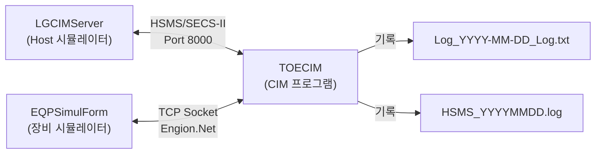

# TOECIM 통합 시뮬레이션 문서

본 문서는 TOECIM 프로젝트의 구현 계획(`implementation_plan.md`)과 시뮬레이션 검증 계획(`simulation_plan.md`)을 통합한 자료입니다. NotebookLM 등의 AI 모델에 컨텍스트로 제공하기 위해 작성되었습니다.

---

## Part 1. 구현 계획 (Implementation Plan)

### 1. 개요
*   **목적**: TOECIM 프로그램의 정상 동작 검증 및 로그 데이터 분석을 위한 시뮬레이션 환경 구축
*   **배경**: 기존 운영 로그와 동일한 형태의 로그가 생성되는지 확인 필요
*   **범위**: LGCIMServer(Host)와 TOECIM(Client) 간의 통신 및 장비 시뮬레이션

### 2. 분석 내용
*   **로그 분석**: `Log_2025-11-06_Log.txt` (CIM 로그) 및 `HSMS_20251106.log` (통신 로그) 포맷 분석 완료
*   **프로젝트 구조**: `LGCIMServer` (Host 시뮬레이터), `TOECIM` (Client), `EQPSimulForm` (장비 조작 UI) 식별
*   **코드 분석**: 
    *   `MainForm.cs`: 주요 버튼 이벤트 및 통신 커맨드 발송 로직 확인
    *   `CIMClient/S*Funcs.cs`: SECS 메시지 (S1, S2, S6 등) 핸들러 구조 파악

### 3. 검증 전략
*   **수동 시뮬레이션**: 자동화가 어려운 UI 조작 기반의 테스트 진행
*   **시나리오 기반 검증**: 정의된 12개 시나리오 수행 후 로그 대조
*   **결과 보고**: 기준 로그와 생성된 로그의 차이점 분석 리포트 작성

---

## Part 2. 시뮬레이션 계획 및 시나리오 (Simulation Plan)

### 1. 시스템 구성도

### 2. 테스트 시나리오 상세

#### [기본 통신 및 상태]
*   **TC-01. HSMS 연결 확인**: Linktest 교환 (45초 주기)
*   **TC-02. 시간 동기화**: S2F31 -> S2F32
*   **TC-07. 루프백 테스트**: S2F25 -> S2F26 (추가)
*   **TC-08. 통신 모드 변경**: Online/Offline 전환 (추가)

#### [장비 제어 및 정보]
*   **TC-09. Ionizer 상태 요청**: S1F75 -> S1F76 (추가)
*   **TC-11. Lot End**: S2F65 -> S2F66 (추가)
*   **TC-12. Cycle Stop**: S2F67 -> S2F68 (추가)

#### [레시피 및 글래스 처리]
*   **TC-03. 레시피 확인**: S7F61 -> S7F62
*   **TC-10. Glass 데이터 요청**: S2F79 -> S2F80 (추가)
*   **TC-04. Glass 투입 (First Glass)**: S2F87 -> S6F67(LR) -> S1F67
*   **TC-05. Glass 배출 (Unload)**: S6F63 -> S6F61

#### [알람]
*   **TC-06. 알람 발생/해제**: S5F1 -> S5F2

### 3. 실행 단계별 상세 절차

| 순서 | 단계 | 주체 (Actor) | 동작 (Action) | 대상 (Target) | 비고 (Details) |
|:---:|:---:|:---:|:---|:---:|:---|
| **1** | **준비** | 사용자 | 프로그램 실행 (LGCIMServer) | Host | Host 실행 후 Port 8000 Listen 확인 |
| **2** | **준비** | 사용자 | 프로그램 실행 (TOECIM) | Client | Client 실행 후 Connect 버튼 클릭 |
| **3** | **연결** | TOECIM | HSMS 연결 요청 | LGCIMServer | Active 모드로 연결 시도 |
| **4** | **연결** | LGCIMServer | Linktest 교환 | TOECIM | 주기적(45초) 연결 상태 확인 |
| **5** | **시나리오 2** | LGCIMServer | 시간 동기화 요청 (S2F31) | TOECIM | Host 시간 전송 |
| **6** | **시나리오 2** | TOECIM | ACK 응답 (S2F32) | LGCIMServer | 정상 수신 확인 |
| **7** | **시나리오 4** | LGCIMServer | 레시피 확인 요청 (S7F61) | TOECIM | Process Program ID 확인 |
| **8** | **시나리오 4** | TOECIM | ACK 응답 (S7F62) | LGCIMServer | 레시피 확인 응답 |
| **9** | **시나리오 4** | LGCIMServer | Glass 데이터 전송 (S2F87) | TOECIM | 투입될 Glass 정보 전송 |
| **10** | **시나리오 4** | TOECIM | ACK 응답 (S2F88) | LGCIMServer | Glass 데이터 수신 확인 |
| **11** | **시나리오 4** | TOECIM | Move LR 보고 (S6F67) | LGCIMServer | Loading Ready 상태 보고 |
| **12** | **시나리오 4** | LGCIMServer | ACK 응답 (S6F68) | TOECIM | 정상 수신 확인 |
| **13** | **시나리오 4** | 사용자 | **LoadDone 버튼 클릭** | EQPSimulForm | 장비 Glass 투입 완료 시뮬레이션 |
| **14** | **시나리오 4** | EQPSimulForm | LoadDone 이벤트 발생 | TOECIM | 내부 이벤트 처리 |
| **15** | **시나리오 4** | TOECIM | 위치 보고 (S1F67) | LGCIMServer | Glass 위치 업데이트 |
| **16** | **시나리오 4** | LGCIMServer | ACK 응답 (S1F68) | TOECIM | 정상 수신 확인 |
| **17** | **종료** | 사용자 | 로그 수집 및 분석 | - | 생성된 로그 파일 확인 |

---
*Generated by Antigravity for NotebookLM Context*
