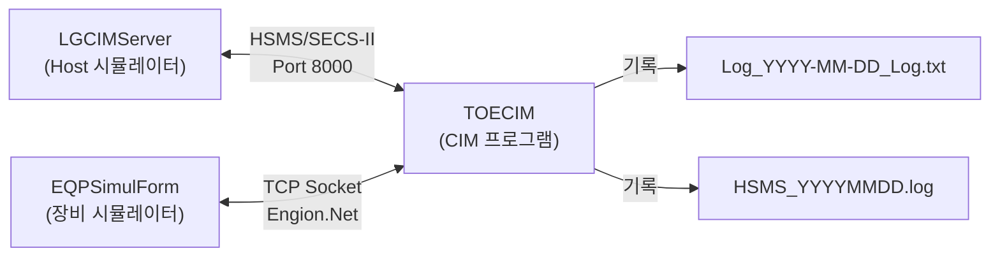
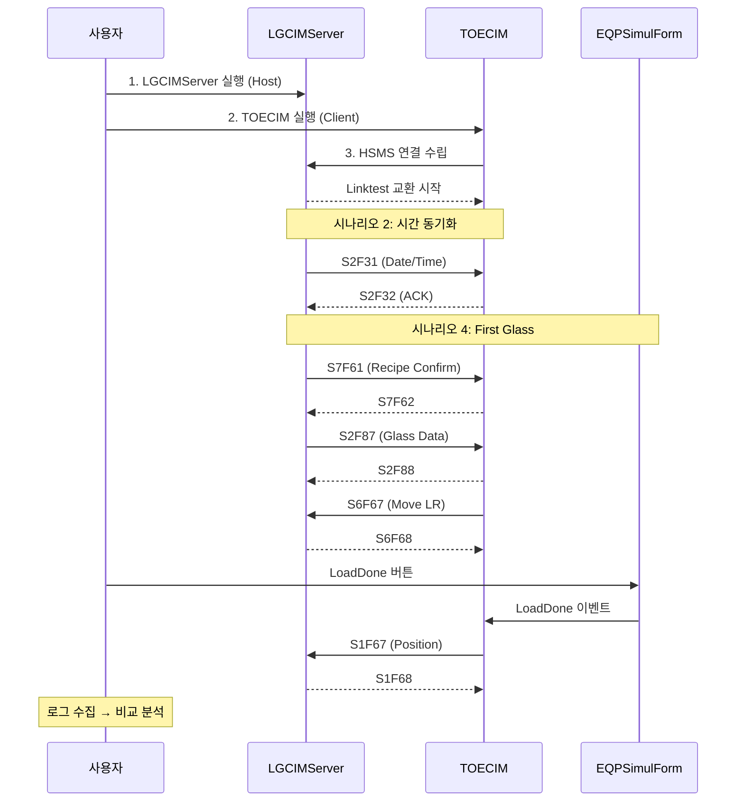

# TOECIM 시뮬레이션 검증 계획

TOECIM 프로그램의 정상 동작 여부를 시뮬레이션을 통해 검증하고, 실제 운영 로그(`Docs/CIM_LOG`)와 동일한 구조의 로그가 남는지 확인합니다.

---

## 1. 시스템 구성도



| 구성 요소 | 역할 | 위치 |
|-----------|------|------|
| **LGCIMServer** | HOST(서버) 시뮬레이터 — SECS/HSMS PASSIVE 모드로 대기 | `LGCIMServer/` |
| **TOECIM** | CIM 클라이언트 — HOST와 통신, 장비 데이터 수집 | `TOECIM/` |
| **EQPSimulForm** | TOECIM 내장 장비 시뮬레이터 — 콘솔/장비 상태 제공 | `TOECIM/Simul/` |

---

## 2. 기준 로그 분석

### 2.1 CIM 로그 (`Log_2025-11-06_Log.txt`)

| 포맷 | 예시 |
|-------|------|
| `MM-DD HH:mm:ss.fff, Level, [Method,Line] Message` | `11-06 07:26:22.461, Information, [Form1_Load,92] S7F61, Recipe ID Confirm Request Received` |

**주요 이벤트 패턴:**

| 단계 | SECS 메시지 | 설명 |
|------|------------|------|
| 시간 동기화 | S2F31 → S2F32 | Host가 시간 전송, CIM이 ACK |
| 레시피 확인 | S7F61 → S7F62 | Host가 레시피 ID 확인 요청 |
| Glass 데이터 | S2F87 → S2F88 | Glass 로딩 데이터 교환 |
| Glass 이동 | S6F67 → S6F68 | Glass Move Request (LR/UW/ER/CR/UR) |
| 상태 보고 | S6F91 → S6F92 | Equipment Status Change Report |
| 위치 보고 | S1F67 → S1F68 | All Glass Position Data Report |
| Unload 보고 | S6F63 → S6F64 | Unload Glass Data Report |
| Load 요청 | S6F61 → S6F62 | Load Glass Data Request |
| LOT 종료 | S6F65 → S6F66 | LOT End Data |
| 알람 발생 | S5F1 → S5F2 | Alarm Report (ALID, ALCD) |

### 2.2 HSMS 로그 (`HSMS_20251106.log`)

| 포맷 | 예시 |
|-------|------|
| `DateTime\tType\tStream\tSystemBytes\t\tW\t"Message"` | `2025-11-06 00:00:00.411\tEtc\t65535\t99051\t\tFalse\t"Send Linktest_Req"` |

주로 Linktest_Req/Rsp 패턴 (45초 주기) + 실제 SECS 메시지 Send/Receive 기록

---

## 3. 테스트 시나리오

### 시나리오 1: HSMS 연결 확인
| 항목 | 내용 |
|------|------|
| **목적** | LGCIMServer와 TOECIM 간 HSMS 연결이 정상적으로 수립되는지 확인 |
| **사전 조건** | LGCIMServer 실행 (Port 8000, PASSIVE), TOECIM 실행 (ACTIVE) |
| **절차** | 1. LGCIMServer 실행 → 포트 열림 확인<br/>2. TOECIM 실행 → 연결 시도<br/>3. Linktest Req/Rsp 교환 확인 |
| **예상 결과** | HSMS 로그에 `Linktest_Req` / `Linktest_Rsp` 쌍이 45초 주기로 기록됨 |
| **검증 기준** | HSMS 로그 형식: `DateTime\tType\tStream\tSystemBytes\t\tW\t"Message"` |

### 시나리오 2: 시간 동기화 (S2F31 → S2F32)
| 항목 | 내용 |
|------|------|
| **목적** | Host → CIM 시간 동기화 메시지가 정상 처리되는지 확인 |
| **절차** | 1. LGCIMServer에서 S2F31 전송<br/>2. TOECIM에서 S2F32 응답 확인 |
| **예상 결과** | CIM 로그: `S2F31, Date and Time Data Send Received` + `S2F32 No Title Sent` |
| **검증 기준** | 로그 포맷: `MM-DD HH:mm:ss.fff, Information, [Form1_Load,92]...` / `[Form1_Load,99]...` |

### 시나리오 3: 레시피 확인 (S7F61 → S7F62)
| 항목 | 내용 |
|------|------|
| **목적** | Host의 레시피 ID 확인 요청이 정상 처리되는지 확인 |
| **절차** | 1. LGCIMServer에서 S7F61 전송<br/>2. TOECIM에서 S7F62 응답 확인 |
| **예상 결과** | CIM 로그: `S7F61, Recipe ID Confirm Request Received` + `S7F62 No Title Sent` |

### 시나리오 4: Glass 처리 전체 사이클 (First Glass)
| 항목 | 내용 |
|------|------|
| **목적** | 첫 Glass 로딩부터 완료까지의 전체 흐름 확인 |
| **절차** | 1. LGCIMServer: S7F61(레시피 확인) → S2F87(Glass 데이터)<br/>2. EQPSimulForm: AutoRun=True, GlassIn 상태 변경<br/>3. TOECIM: S2F88 응답 → S6F67(LR) 발행<br/>4. EQPSimulForm: LoadDone 이벤트 발생<br/>5. TOECIM: S1F67 발행 → S6F91(상태변경) 발행 |
| **예상 결과** | 다음 순서의 로그 기록: |

```
S7F61 → S7F62
S2F87 → GetStatusFromConsole(Ionizer) → S2F88
NextGlassProcess → S6F67(LR) → S6F68 ACK
SendS2F88(Glass Count, LOTID)
LoadDone → S1F67 → S1F68
```

### 시나리오 5: Glass Exchange 사이클
| 항목 | 내용 |
|------|------|
| **목적** | Glass Exchange(교환) 처리 흐름 확인 |
| **절차** | 1. EQPSimulForm에서 InspectDone → ExchangeReadyDone 순차 발생<br/>2. TOECIM: S6F63(Unload 보고) + S6F61(Load 요청)<br/>3. LGCIMServer: S2F87 → TOECIM: S2F88<br/>4. TOECIM: S6F67(UW) + S6F67(ER) 발행<br/>5. EQPSimulForm: ExchangeDone 발생<br/>6. TOECIM: S1F67(위치보고) 발행 |
| **예상 결과** | 다음 순서의 로그 기록: |

```
InspectDone → ExchangeReadyDone
S6F63 → S6F64, S6F61 → S6F62
S2F87 → Ionizer 상태 → S2F88
NextGlassProcess → S6F67(UW) + S6F67(ER)
ExchangeDone → S1F67 → S1F68
S6F65(LOT End) → S6F66 + S6F83 → S6F84
```

### 시나리오 6: 알람 발생 및 해제 (S5F1 → S5F2)
| 항목 | 내용 |
|------|------|
| **목적** | 알람 발생/해제 시 S5F1 메시지가 정상적으로 기록되는지 확인 |
| **절차** | 1. EQPSimulForm에서 알람 SET (ALID: ALIGN_FAIL)<br/>2. TOECIM: S5F1 전송 (ALCD: 134=SET)<br/>3. EQPSimulForm에서 알람 CLEAR<br/>4. TOECIM: S5F1 전송 (ALCD: 6=CLEAR) |
| **예상 결과** | CIM 로그 기록: |

```
S5F1 No Title Sent
[S5F1] Alarm Report Complete. ALID : ALIGN_FAIL, ALCD : 134
S5F2, Alarm Report Acknowledge Received
(AlarmClear 후)
[S5F1] Alarm Report Complete. ALID : ALIGN_FAIL, ALCD : 6
S5F2, Alarm Report Acknowledge Received
```

---

## 4. 검증 방법

### 4.1 로그 비교 기준

| 비교 항목 | 기준 로그 경로 | 검증 내용 |
|-----------|---------------|----------|
| CIM 로그 포맷 | `Docs/CIM_LOG/Log_2025-11-06_Log.txt` | `MM-DD HH:mm:ss.fff, Level, [Method,Line] Message` 형식 일치 |
| HSMS 로그 포맷 | `Docs/CIM_LOG/HSMS_20251106.log` | `DateTime\tType\tStream\tSysBytes\t\tW\t"Message"` 형식 일치 |
| 메시지 시퀀스 | 기준 로그의 정상 사이클 | SECS 메시지 순서(Request→Response) 일치 |
| Console 상태 | Ionizer 상태 기록 | `GetStatusFromConsole` 로그가 기록됨 |

### 4.2 검증 절차

1. **빌드**: 솔루션 전체 빌드 (`TOECIM.sln`)
2. **실행**: LGCIMServer → TOECIM (EQPSimulForm 활용) 순서로 실행
3. **시나리오 수행**: 위 6개 시나리오를 순서대로 실행
4. **로그 수집**: 시뮬레이션 후 생성된 로그 파일 수집
5. **비교 분석**: 기준 로그와 구조/포맷/메시지 시퀀스 비교

> [!IMPORTANT]
> 시뮬레이션은 **수동 UI 조작**이 필요합니다. LGCIMServer와 TOECIM의 EQPSimulForm을 사용자가 직접 조작해야 합니다. 자동화가 불가능한 영역이므로, 계획 승인 후 사용자가 시뮬레이션을 실행하고, 생성된 로그 파일을 분석하는 방식으로 진행합니다.

---

## 5. 실행 순서


